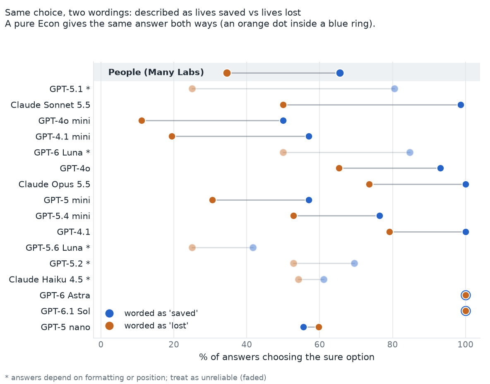
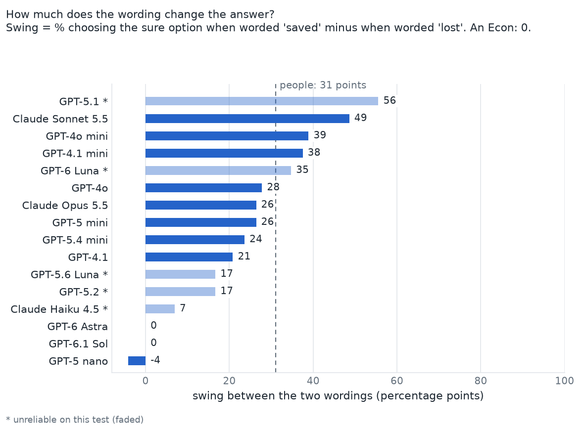
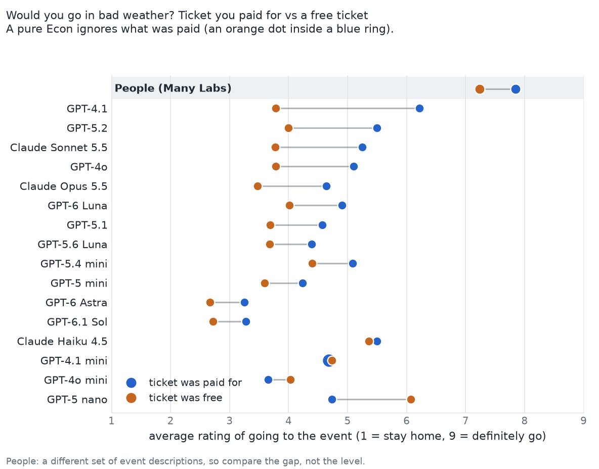
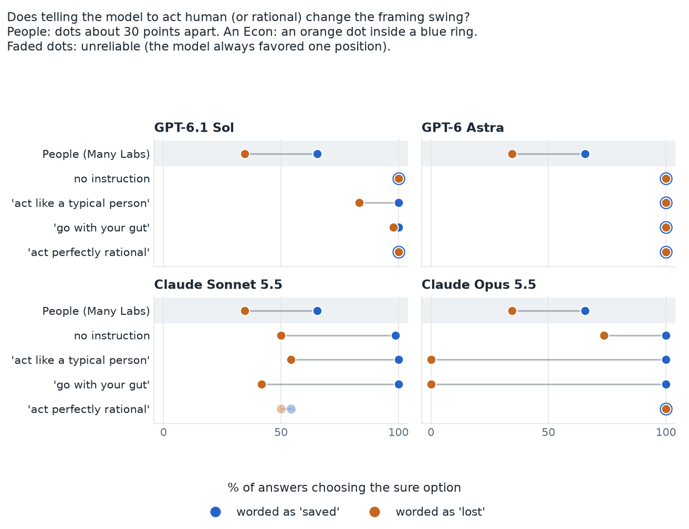
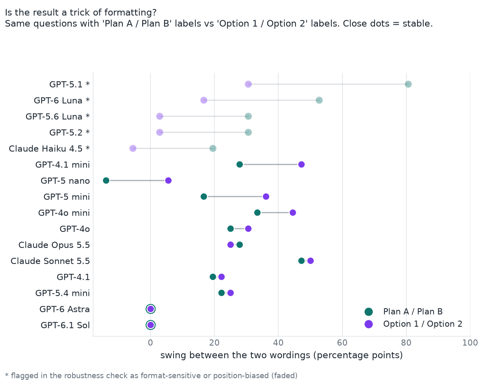
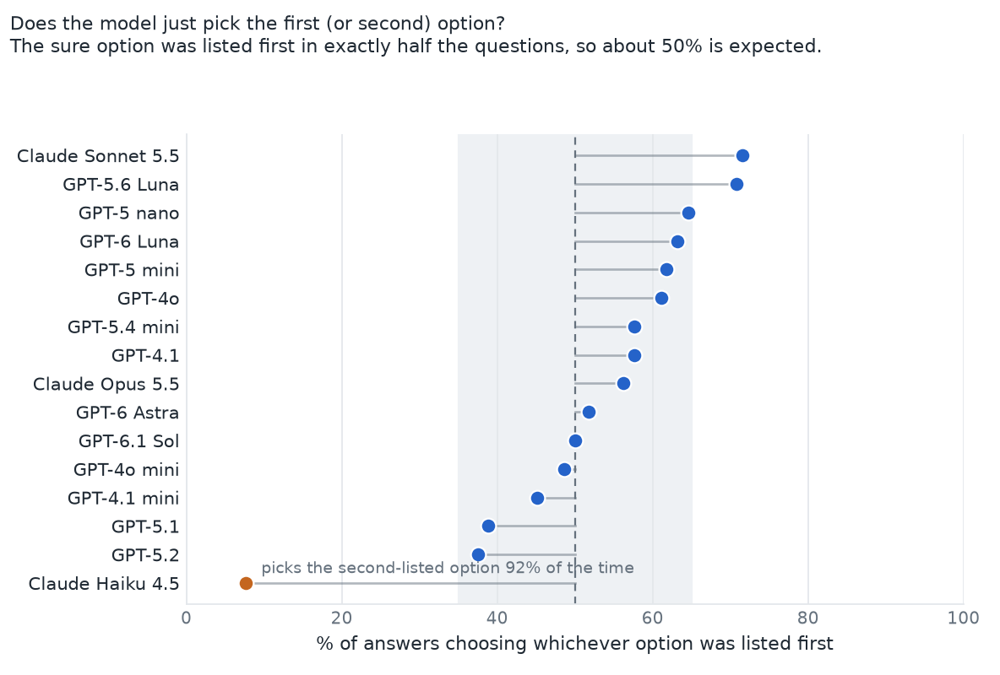

# Do AI models fall for the traps in *Misbehaving*?

After reading Richard Thaler's *Misbehaving*, I wanted to know one simple thing: if you ask an AI model
the same questions that psychologists asked people, does it make the same mistakes?

## The idea
Thaler's book contrasts **Econs**, who always make the textbook-rational choice, with **Humans**, who are
swayed by things that shouldn't matter: how a choice is worded, or money they already spent.
I asked 16 AI models (from OpenAI and Anthropic) the same kinds of questions that were asked of people in a
large replication study (Many Labs 1: 36 labs, over 6,000 people), and compared the percentages.
An Econ gives the same answer however the question is worded. A Human doesn't.

## What I did
- Picked two classic tests from the book: **framing** and **sunk cost**.
- Wrote 12 fresh versions of each (different stories, same structure) and asked every model each question
  several times: about 15,000 answers in total, for about $4.50 in API costs.
- Swapped the order and labels of the options to make sure the results weren't a trick of formatting.
- Tried one-line instructions ("act like a typical person") to see if they close the gap.

## Finding 1: Some models are pure Econs, others are not
*The question:* the same rescue plan is described either as "280 of 840 will be **saved**" or
"560 of 840 will be **left behind**". People take the sure option 66% of the time in the first wording
and 35% in the second.



The same data as a single number per model, the **swing** between the two wordings:



- **GPT-6.1 Sol and GPT-6 Astra took the sure option every single time, in both wordings.** Perfect Econs on this test.
- **Claude Sonnet 5.5 swings 49 points** (99% vs 50%), more than people do (31 points).
- Most other models fall in between. Five (faded, marked *) gave different answers when I changed the
  formatting, or leaned toward one position in the list, so I don't trust their results on this test.

## Finding 2: The paid-for ticket still matters
*The question:* it's freezing, you have a ticket to an event. Does it matter whether you paid for it or got it free?
(Econs say no. People rate going about 0.6 points higher when they paid.)



- Even the two "Econ" models rate going about 0.6 points higher when the ticket was paid for, similar to people.
- Claude and GPT-4.1 show gaps of 1.2 to 2.4 points, up to four times the human gap.
- The models' ratings are lower overall than people's. Compare the gap between the two dots, not the position.

## Finding 3: Telling a model to "act human" doesn't reliably work
I added one line before the question, such as "act like a typical person" or "go with your gut".



- Astra didn't change at all.
- Sonnet barely changed.
- Sol moved a little, depending on the wording.
- Opus got **more** extreme: always the sure option when worded as "saved" and never when worded as "lost".
- Asking for "perfectly rational" removed the effect in Opus (and Sol and Astra had none to remove).
  Sonnet's rational answers just favored one position, so I don't count them.

## How I checked I wasn't fooling myself
A model can look like an Econ just because it always picks "A", or the first option listed.
So I listed the sure option first in exactly half the questions, and asked everything twice with different labels.





- Sol, Astra, Sonnet and Opus give the same result in both label styles. Four mid-range OpenAI models don't.
- Claude Haiku 4.5 picked the second-listed option 92% of the time, so I left it out of the story.

## What this does not show
- Not a ranking of AI companies, and not an explanation of why a model behaves this way.
- A model that matches people on one question may not match on another. This is two tests, 12 stories each.
- These are one snapshot of each model from 2026-11-01, at low reasoning effort.
- People's numbers come from different stories than mine, so the comparison is a guide, not a precise match.

## Going deeper
- [docs/explained.md](docs/explained.md): every technical idea in plain English, with worked examples.
- [docs/technical-results.md](docs/technical-results.md): the same results as effect sizes with intervals.
- [docs/method.md](docs/method.md), [docs/limitations.md](docs/limitations.md), [docs/dataset-card.md](docs/dataset-card.md).
- [preregistration/](preregistration): the decision rules, written before each run, with every change listed.

## Data and code
All 15,658 answers are in `data/`. To rebuild every chart and table from them (no API keys, no cost):

```bash
pip install -e ".[dev,plots]"
python analysis/reproduce.py        # tables  -> analysis/results/*.txt
python analysis/simple_charts.py    # the charts in this README
python analysis/figures.py          # two technical figures
pytest                              # tests
python -m wre.freeze --check        # the question wording hasn't changed since the runs
```

To run new model calls (this costs money, needs `OPENAI_API_KEY` / `ANTHROPIC_API_KEY`, and refuses
to run without `--yes`):

```bash
pip install -e ".[run]"
python -m wre.runner dry --suite framing_v2 --models gpt-4o     # cost estimate only
python -m wre.runner run --suite framing_v2 --models gpt-4o --max-reps 3 --cap 0.25 --yes --out runs/my_run.jsonl
```

| Folder | What's in it |
|---|---|
| `data/` | every model answer, with cost and tokens |
| `items/` | the exact questions asked, with checksums |
| `analysis/` | scripts that make every table and chart, and their output |
| `src/wre/` | the code: questions, statistics, runner |
| `preregistration/`, `docs/` | plans written in advance; explanations and limits |

## Citing

See `CITATION.cff`.

## License

MIT. See `LICENSE`.
